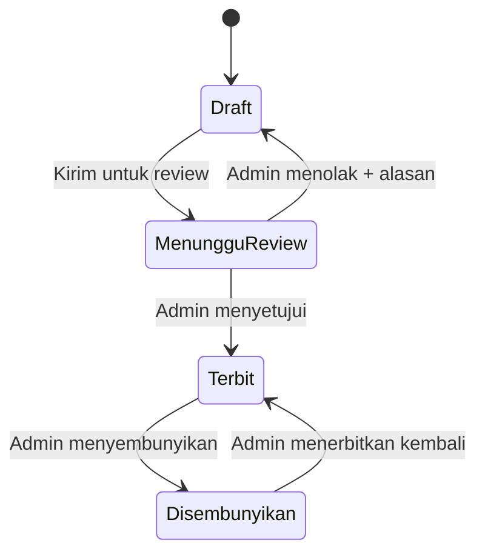

# Design System & Layout — Website Kajian Dakwah

> Dokumen ini menjadi acuan visual, tata letak, dan pengalaman pengguna untuk website kajian yang melayani Pengunjung, Contributor, dan Admin. Pendekatan utama: **mobile-first**, ringan, nyaman dibaca, dan mudah digunakan oleh pengurus maupun jamaah dari berbagai usia.

## 1. Arah desain

Website mengambil inspirasi dari referensi aplikasi audio: struktur yang berorientasi konten, kartu dengan sudut membulat, aksen warna oranye untuk tindakan utama, serta pemutar audio yang dapat diakses tanpa berpindah halaman. Perbedaannya, website kajian menggunakan kanvas putih dan hijau tua agar terasa lebih terbuka, hangat, terpercaya, dan sesuai konteks dakwah.

Prinsip desain:

1. **Dakwah-first** — konten kajian menjadi fokus utama, bukan dekorasi atau fitur teknis.
2. **Tenang dan premium** — banyak ruang putih, tipografi kuat, bayangan lembut, dan ornamen islami yang sangat halus.
3. **Satu tindakan utama per layar** — pengunjung selalu tahu harus membaca, mendengarkan, menonton, atau membuka rujukan.
4. **Audio tidak terputus** — mini-player tetap menempel ketika pengguna menjelajah konten lain.
5. **Ramah semua usia** — ukuran teks nyaman, label jelas, target sentuh besar, dan tidak bergantung pada ikon saja.
6. **Status konten transparan** — Contributor selalu dapat memahami apakah konten masih draft, menunggu review, terbit, atau perlu diperbaiki.

## 2. Kepribadian merek

- **Hangat:** tidak terasa seperti portal berita yang kaku.
- **Amanah:** informasi sumber, ustadz, kategori, dan status publikasi mudah ditemukan.
- **Modern:** tampilan bersih seperti aplikasi media premium, tanpa kehilangan kesederhanaan.
- **Reflektif:** penggunaan warna dan animasi tidak berlebihan agar mendukung suasana belajar dan tadabbur.

## 3. Warna

### Warna inti

| Token                  | Hex       | Penggunaan                                      |
| ---------------------- | --------- | ----------------------------------------------- |
| `--color-surface`      | `#FFFFFF` | Latar utama dan kartu terang                    |
| `--color-surface-soft` | `#FFF9F2` | Latar section, highlight, empty state           |
| `--color-ink`          | `#173B32` | Judul, navigasi aktif, tombol gelap             |
| `--color-ink-deep`     | `#0E2A24` | Header premium, footer, dashboard sidebar       |
| `--color-brand`        | `#F28C28` | CTA, progress audio, badge penting, link aktif  |
| `--color-brand-dark`   | `#C96B10` | Hover, pressed state, teks di atas latar terang |
| `--color-brand-soft`   | `#FFF0DC` | Background badge dan highlight oranye           |
| `--color-text`         | `#26332F` | Body text                                       |
| `--color-muted`        | `#6F7D77` | Metadata, helper text, placeholder              |
| `--color-border`       | `#E7ECE8` | Border kartu, divider, input                    |
| `--color-success`      | `#2E8B57` | Terbit, disetujui, berhasil                     |
| `--color-warning`      | `#B87513` | Menunggu review                                 |
| `--color-danger`       | `#B94A48` | Ditolak, validasi error                         |

### Aturan kontras

- Teks utama menggunakan `--color-ink` atau `--color-text`, bukan abu-abu muda.
- Tombol oranye memakai teks `#2B2117` atau hijau tua dengan kontras tinggi.
- Jangan menggunakan teks putih kecil di atas oranye terang.
- Semua status disampaikan dengan **warna + teks + ikon**, bukan warna saja.

## 4. Tipografi

Rekomendasi font:

- **Heading:** `Plus Jakarta Sans` atau `Manrope`, weight 600–700.
- **Body:** `Inter` atau `Plus Jakarta Sans`, weight 400–500.
- **Kutipan Arab/ayat:** `Amiri` atau `Noto Naskh Arabic`, line-height lebih longgar.

Skala mobile:

| Elemen       | Ukuran | Weight | Line height |
| ------------ | ------ | ------ | ----------- |
| Display hero | 32 px  | 700    | 1.15        |
| H1 halaman   | 28 px  | 700    | 1.2         |
| H2 section   | 22 px  | 700    | 1.25        |
| H3 kartu     | 17 px  | 650    | 1.35        |
| Body besar   | 16 px  | 400    | 1.65        |
| Body standar | 14 px  | 400    | 1.6         |
| Caption/meta | 12 px  | 500    | 1.4         |
| Label tombol | 14 px  | 650    | 1           |

Desktop dapat menaikkan display hero menjadi 48–56 px, tetapi body text dibatasi sekitar 65–75 karakter per baris agar nyaman dibaca.

## 5. Spacing, bentuk, dan elevation

Gunakan skala spacing berbasis 4 px: `4, 8, 12, 16, 20, 24, 32, 40, 48, 64`.

- Radius kecil: `8 px` untuk input dan badge.
- Radius standar: `16 px` untuk kartu konten.
- Radius besar: `24 px` untuk hero dan kartu unggulan.
- Tombol pill: `999 px` hanya untuk filter, tag, dan kontrol audio.
- Shadow kartu: `0 8px 24px rgba(23, 59, 50, .08)`.
- Shadow floating player: `0 10px 30px rgba(14, 42, 36, .16)`.
- Border default: `1 px solid var(--color-border)`.

Hindari terlalu banyak garis. Gunakan grouping, ruang kosong, dan perbedaan warna permukaan untuk membangun hierarki.

## 6. Struktur global responsive

### Mobile — 320–767 px

- Header tinggi sekitar 64 px: logo kiri, pencarian dan menu profil di kanan.
- Navigasi utama berada di **bottom navigation** dengan 4 item: Beranda, Jelajah, Simpanan, Profil.
- Konten menggunakan padding horizontal 16 px.
- Semua daftar konten satu kolom.
- Kartu audio memakai format horizontal: thumbnail 64–72 px, judul maksimal 2 baris, tombol play 40 px.
- Mini-player audio berada di atas bottom navigation dan memiliki tinggi 68–76 px.
- Filter kategori dapat digeser horizontal; jangan memaksa semua chip masuk satu baris.
- Form contributor menggunakan satu kolom dan tombol submit sticky di bawah saat keyboard tidak aktif.

### Tablet — 768–1199 px

- Header menjadi top navigation penuh dengan logo, menu utama, search, dan tombol masuk.
- Bottom navigation diganti sidebar ringan atau top navigation.
- Grid konten menjadi 2 kolom untuk kartu artikel/video dan daftar audio tetap 1–2 kolom.
- Padding konten 32–48 px.
- Detail konten dapat memakai layout 65/35: isi utama dan panel metadata/playlist.
- Dashboard memakai sidebar 224 px dan area kerja fleksibel.

### Desktop — 1200 px ke atas

- Container maksimum `1200–1280 px`, terpusat.
- Header: logo, Beranda, Artikel, Audio Kajian, Video Pendek, Link Rujukan, search, dan CTA Login.
- Homepage memakai hero dua kolom: copy/value proposition di kiri dan kartu kajian pilihan di kanan.
- Section konten menggunakan grid 3 kolom; daftar audio dapat menggunakan tabel/list dengan density nyaman.
- Detail artikel/audio: kolom utama 720–760 px dan sidebar 300–340 px.
- Dashboard admin menggunakan sidebar 248 px, topbar, dan area konten dengan grid statistik 4 kartu.

## 7. Arsitektur halaman pengunjung

### 7.1 Beranda

Urutan vertikal mobile:

1. Header ringkas dan logo.
2. Hero dengan sapaan: **“Temukan kajian yang menenangkan hati.”**
3. Search field besar: “Cari judul, ustadz, atau topik”.
4. Quick actions berbentuk empat kartu kecil: Artikel, Audio Kajian, Video Pendek, Link Rujukan.
5. Section **Kajian pilihan** dengan satu featured card.
6. Section **Terbaru** dengan tab/filter: Semua, Artikel, Audio, Video.
7. Section **Topik populer** berupa chip hijau lembut.
8. Footer ringkas dan informasi sumber.

Hero desktop dapat menggunakan bidang hijau tua dengan ornamen pola geometris islami opacity rendah. Jangan menggunakan foto manusia sebagai satu-satunya cara menyampaikan nilai; teks dan CTA harus tetap jelas.

### 7.2 Jelajah konten

- Header halaman: judul, deskripsi pendek, jumlah konten.
- Search dan filter sticky ringan.
- Filter berdasarkan jenis konten, kategori, ustadz/pengisi, durasi, dan tanggal.
- Kartu konsisten dengan badge tipe konten.
- Empty state: ilustrasi sederhana, teks “Belum ada kajian yang sesuai”, dan tombol hapus filter.

### 7.3 Detail artikel

- Breadcrumb di tablet/desktop; pada mobile cukup tombol kembali.
- Badge kategori dan waktu baca.
- Judul besar, ringkasan, nama penulis/pengisi, tanggal terbit.
- Tombol simpan dan bagikan dekat judul.
- Isi artikel menggunakan lebar baca optimal dan paragraf pendek.
- Blockquote/kutipan diberi border kiri oranye dan background `--color-surface-soft`.
- Bagian sumber/rujukan tampil sebagai kartu terpisah.
- Artikel terkait muncul setelah isi.

### 7.4 Detail audio kajian

- Cover/thumbnail berbentuk persegi dengan radius 20 px.
- Judul, pengisi, kategori, durasi, dan tanggal.
- Audio player besar dengan play/pause, scrubber, durasi, kecepatan, dan volume.
- Tombol **Unduh audio** dan **Simpan**.
- Transkrip atau ringkasan kajian berada di bawah player dengan accordion.
- Desktop: player dan metadata berada di kiri; playlist/rujukan di sidebar.

### 7.5 Video pendek

- Mobile: kartu rasio 9:16 atau 4:5 dengan judul dan durasi di overlay bawah.
- Desktop: grid 4:5 agar tidak terlalu memenuhi layar.
- Video tidak autoplay dengan suara. Gunakan poster image dan tombol play yang jelas.
- Detail video menampilkan caption, topik, sumber, dan video terkait.

### 7.6 Link rujukan

Link eksternal harus diberi tanda “Membuka website lain” dan ikon external-link. Tampilkan domain tujuan, deskripsi singkat, dan kategori. Jangan menyamarkan tautan eksternal sebagai link internal.

## 8. Navigasi dan komponen utama

### Header

Logo berupa wordmark sederhana dengan simbol lingkaran/oranye yang mengingatkan pada titik cahaya atau mihrab abstrak. Header mobile tidak lebih dari dua baris. Search dibuka sebagai halaman/overlay penuh agar mudah digunakan.

### Kartu konten

Setiap kartu memiliki pola tetap:

- Thumbnail atau ikon tipe konten.
- Badge: `ARTIKEL`, `AUDIO`, `VIDEO`, atau `RUJUKAN`.
- Judul maksimal 2–3 baris.
- Metadata: pengisi/penulis, tanggal, durasi atau estimasi baca.
- Satu affordance utama: baca, play, tonton, atau buka.

### Mini-player audio

Mini-player mengikuti inspirasi referensi audio namun dibuat lebih lembut:

- Thumbnail 44 px.
- Judul dan nama pengisi di tengah.
- Progress line oranye tipis.
- Tombol pause/play 40 px.
- Tombol expand dan close opsional.
- Pada mobile berada di atas bottom navigation; pada desktop melebar maksimum 680 px dan berada di tengah bawah.

### Tombol

- Primary: hijau tua atau oranye untuk tindakan utama, tinggi minimal 44 px.
- Secondary: putih dengan border hijau muda.
- Tertiary: teks hijau tua tanpa container.
- Destructive: hanya untuk admin, menggunakan merah dengan konfirmasi.
- Ikon selalu disertai label untuk tindakan penting seperti Unduh, Simpan, Kirim Review.

## 9. Alur Contributor

### Dashboard contributor

Mobile:

1. Header dengan sapaan dan avatar.
2. Ringkasan status dalam 3 kartu horizontal yang dapat digeser: Draft, Menunggu Review, Terbit.
3. CTA besar **Buat konten baru**.
4. Daftar konten saya dengan filter status.

Desktop:

- Sidebar: Ringkasan, Konten Saya, Buat Konten, Profil.
- Topbar: search, notifikasi review, avatar.
- Area utama: statistik kecil, CTA, tabel/list konten.

### Form pembuatan konten

Gunakan stepper pada mobile jika form panjang:

1. Pilih jenis konten.
2. Isi informasi utama.
3. Tambahkan media/tautan.
4. Pratinjau dan kirim review.

Field wajib diberi tanda jelas. Auto-save draft ditampilkan dengan teks ringan “Tersimpan 2 menit lalu”. Tombol utama: **Simpan Draft** dan **Kirim untuk Review**. Saat ditolak, tampilkan alasan admin tepat di bagian atas form dan pertahankan isi lama.

## 10. Alur Admin

### Dashboard admin

- Sidebar tetap di desktop, drawer di mobile.
- Statistik utama: Total konten, Menunggu review, Pengunjung 30 hari, Konten terpopuler.
- Antrian review menjadi blok paling menonjol setelah statistik.
- Tabel desktop berubah menjadi kartu bertumpuk di mobile.
- Tindakan review: Pratinjau, Setujui, Minta Perbaikan/Tolak.
- Dialog konfirmasi wajib menjelaskan dampak tindakan dan menyediakan kolom alasan untuk penolakan.

Menu admin:

- Dashboard
- Review konten
- Semua konten
- Pengguna / Contributor
- Kategori & tag
- Statistik
- Pengaturan

## 11. Siklus status konten

Tampilan status:

- **Draft:** badge abu-hijau, teks “Belum dikirim”.
- **Menunggu Review:** badge amber, teks “Sedang diperiksa”.
- **Terbit:** badge hijau, teks “Tayang di website”.
- **Perlu Perbaikan:** badge merah lembut, selalu disertai alasan.
- **Disembunyikan:** badge abu gelap, tampilkan tanggal dan pelaku perubahan di admin.

## 12. Statistik dan data

Statistik publik cukup sederhana: jumlah kajian, total audio, total video, dan konten terpopuler. Dashboard admin dapat menampilkan grafik 30 hari dengan label yang terbaca, tooltip keyboard-accessible, serta filter rentang waktu. Hindari dashboard yang terlalu padat; insight utama harus terlihat dalam 5 detik.

## 13. Accessibility dan UX quality bar

- Target sentuh minimal 44 × 44 px.
- Semua input mempunyai label, helper text, dan pesan error yang spesifik.
- Focus state terlihat jelas dengan outline hijau/oranye.
- Navigasi keyboard harus mengikuti urutan visual.
- Video menyediakan caption jika tersedia.
- Audio memiliki kontrol yang dapat diakses tanpa mouse.
- Gunakan heading semantik dan landmark: header, nav, main, aside, footer.
- Jangan autoplay audio/video.
- Hormati `prefers-reduced-motion`; animasi cukup berupa fade/slide maksimal 200 ms.
- Loading memakai skeleton yang menyerupai bentuk konten, bukan spinner panjang.
- Toast tidak boleh menjadi satu-satunya tempat menyampaikan hasil penting; status juga terlihat pada halaman.

## 14. Motion dan feedback

Gunakan motion yang tenang:

- Hover kartu: translateY `-2 px` dan shadow sedikit lebih kuat.
- Tombol tekan: scale `0.98`.
- Progress audio bergerak halus.
- Setelah menyimpan: ikon berubah dan label “Tersimpan”.
- Setelah mengirim review: tampilkan halaman sukses dengan status dan langkah berikutnya.

Tidak digunakan: parallax berat, autoplay carousel, bounce berlebihan, atau efek neon.

## 15. Responsive acceptance checklist

### Mobile

- Pengunjung bisa menemukan empat tipe konten dalam satu scroll awal.
- Audio dapat diputar, dijeda, dan dilanjutkan saat berpindah halaman.
- Tidak ada tabel horizontal yang memaksa zoom.
- Form contributor dapat diselesaikan dengan satu tangan.

### Tablet

- Grid 2 kolom tidak membuat judul terpotong.
- Detail konten memanfaatkan ruang samping tanpa memperkecil area baca.
- Sidebar dashboard dapat dibuka/tutup dengan jelas.

### Desktop

- Container tidak melebar tanpa batas.
- Navigasi utama tetap terlihat tanpa mengorbankan ruang konten.
- Review admin bisa dilakukan dari satu halaman: baca/pratinjau, lihat metadata, lalu putuskan.

## 16. Contoh microcopy

- Search: **“Cari kajian, ustadz, atau topik”**
- Empty content: **“Belum ada kajian di kategori ini.”**
- Draft tersimpan: **“Draft tersimpan otomatis.”**
- Review: **“Konten akan diperiksa sebelum tampil untuk umum.”**
- Ditolak: **“Ada yang perlu diperbaiki. Lihat catatan admin di bawah.”**
- External link: **“Anda akan diarahkan ke website lain.”**
- Download: **“Unduh audio untuk didengarkan tanpa koneksi.”**

## 17. Rekomendasi prioritas implementasi

**MVP:** Beranda, katalog artikel/audio/video/link, detail konten, audio player sticky, login contributor/admin, draft–review–terbit, dan dashboard review dasar.

**Fase berikutnya:** bookmark/simpanan, transkrip audio, notifikasi review, statistik lanjutan, PWA/install prompt, dan pencarian yang lebih cerdas.

**Guardrail produk:** pengunjung tetap dapat mengakses konten publik tanpa akun; pendaftaran contributor terbuka lewat `/daftar` dengan verifikasi email dan role awal selalu `CONTRIBUTOR` (peningkatan role hanya oleh admin); setiap konten publik harus memiliki sumber atau identitas pengisi yang jelas; tindakan admin yang mengubah visibilitas konten harus tercatat.
